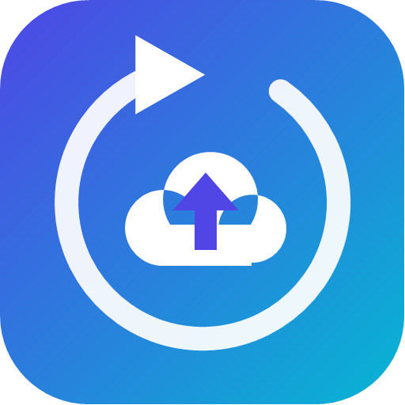
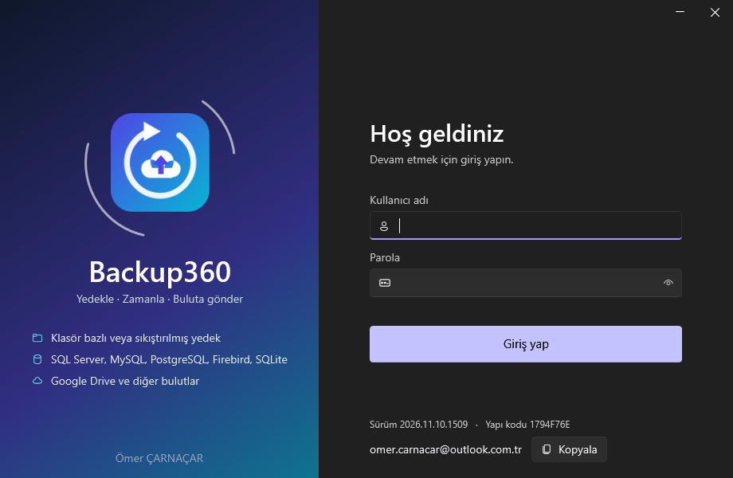
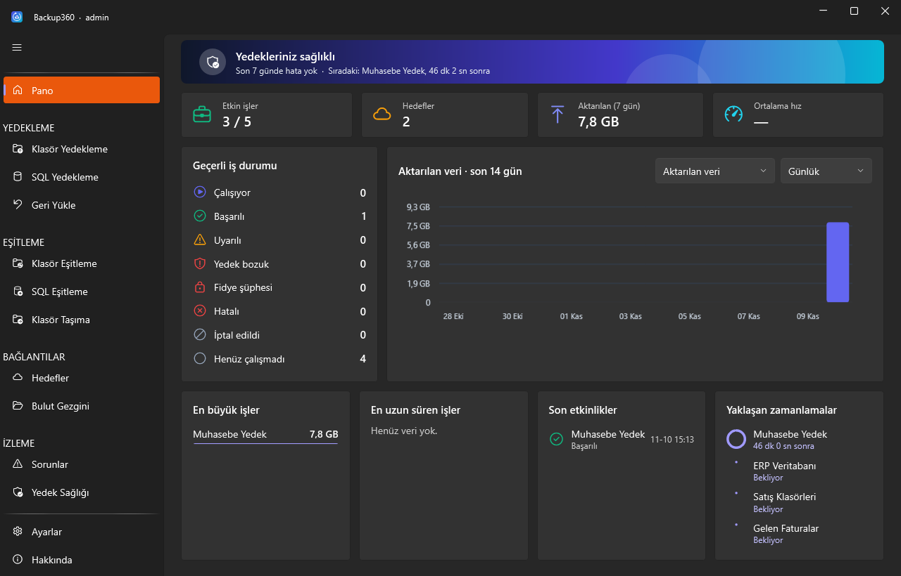
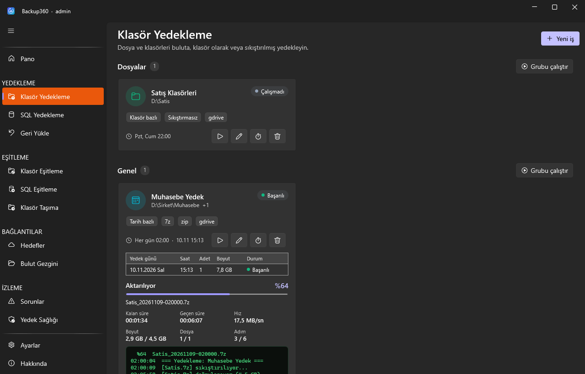
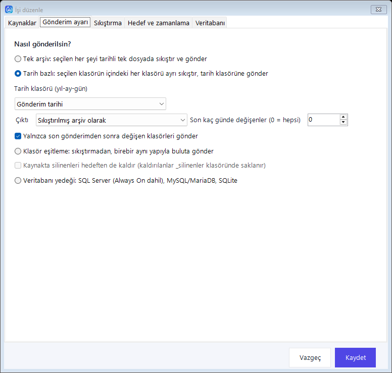
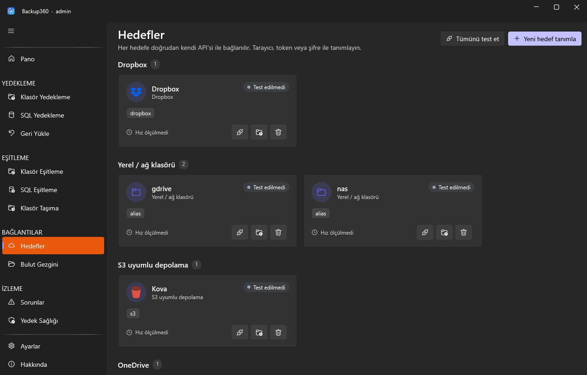
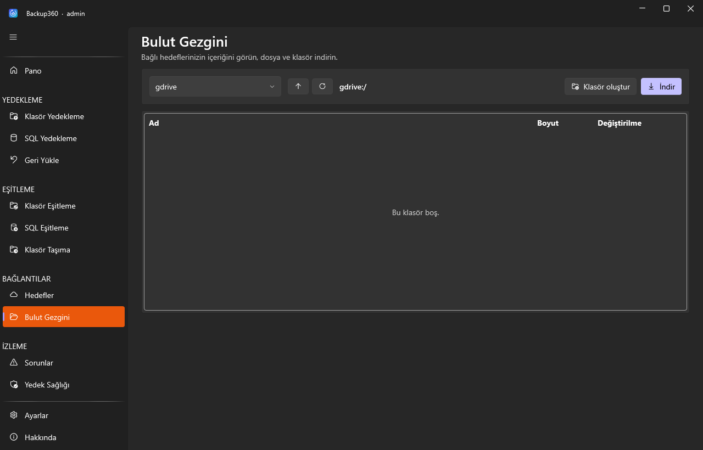

<div align="center">



# Backup360

**Dosya, klasör ve veritabanlarınızı en yüksek sıkıştırmayla buluta yedekler**
_Tüm arşiv formatları · SQL Server, Always On, MySQL, PostgreSQL, Firebird, SQLite · Fidye yazılımı koruması_

[](https://github.com/OmerCarnacar/backup360/releases/latest)
[](https://github.com/OmerCarnacar/backup360/releases)
[-059669)](LICENSE)
[](#kurulum)

**[⬇ Son sürümü indirin](https://github.com/OmerCarnacar/backup360/releases/latest)**

</div>

---

## Ekran görüntüleri

 
 
 

## Özellikler

| | |
|---|---|
| 🗜️ **Tüm arşiv formatları** | 7z, zip, rar, tar, tar.gz, tar.bz2, tar.xz, tar.zst, wim. Aynı anda birden çok format seçilebilir. Varsayılan seviye en yüksektir. |
| 🛢️ **Veritabanı yedeği** | SQL Server (Full, Differential, Log), MySQL/MariaDB, PostgreSQL, Firebird ve SQLite. Her yedek doğrulanır, sıkıştırılır ve gönderilir. |
| 🧪 **Geri yükleme sınavı** | SQL Server, PostgreSQL ve Firebird yedekleri geçici veritabanına geri yüklenerek sınanır; SQL Server'da `DBCC CHECKDB` çalışır. |
| ⚠️ **Sorunlar** | Hatalar, uyarılar, yedeklenemeyen dosyalar ve buluta aktarılamayan öğeler gün gün listelenir; düzelince kayıt kendiliğinden kapanır. |
| 💾 **Yerel yedek veya bulut** | İş yalnızca yerel klasöre, yalnızca buluta veya ikisine birden yedekleyebilir. Yarıda kalan Google Drive gönderimi kaldığı yerden sürer. |
| 🩺 **Yedek Sağlığı** | Hedefteki yedeklerin parmak izi düzenli denetlenir, eksik veya bozulan dosya bildirilir. |
| 🛡️ **Fidye yazılımı koruması** | Şifrelenme belirtisi veya toplu değişim görülürse yedek ve eşitleme durur, sağlam yedeklere dokunulmaz, e-posta ve ekran uyarısı verilir. |
| 🔎 **SQL Server taraması** | Bu bilgisayardaki ve yerel ağdaki SQL Server örneklerini listeler; varsayılan port 1433. |
| 🔁 **Always On** | Yedek tercih edilen replikadan alınır. İkincilde COPY_ONLY ve eşitleme kuralları otomatik uygulanır. |
| ☁️ **Çoklu hedef** | Google Drive, OneDrive, Dropbox, S3, SFTP, FTP, WebDAV, SMB, yerel disk, USB veya ağ klasörü. Her birine doğrudan kendi API'si ile bağlanılır. |
| 📁 **Çoklu kaynak** | Dosyalar, klasörler, USB ve `\\SUNUCU\Paylasim` ağ alanları tek işte toplanabilir. |
| 📅 **Tarih bazlı gönderim** | Seçilen klasörün içindeki her klasör, sıkıştırılmış veya klasör olarak `2026-11-09/` gibi tarih klasörüne gönderilir. |
| 🗓️ **Gün sayısına göre** | Yalnızca son N günde değişen klasörleri gönderin, N günden eski yedekleri otomatik silin. Her öğenin en yeni yedeği korunur. |
| 📂 **Klasör bazlı (varsayılan)** | Dosya ve klasörler olduğu gibi, aynı yapıyla gönderilir. "Sıkıştırarak gönder" seçilirse arşivlenir. |
| 🔄 **Klasör ve SQL eşitleme** | Yedekleri başka klasöre, NAS'a veya farklı PC'ye yalnızca farkları aktararak eşitler. "Farkları göster" ile önce görebilirsiniz. |
| 🗂️ **Bulut Gezgini** | Bağlı hedeflerin içeriğini gezin, dosya ve klasör indirin. |
| 📈 **Anlık takip** | Sıkıştırma ve yükleme yüzdesi, o anki işlem, dosya dosya akış ve Canlı Günlük. |
| 🗂️ **Gruplar** | İşleri ve kuralları gruplayın, bir grubu tek tıkla sırayla çalıştırın. |
| ⏰ **Zamanlama** | Dakika, saat, gün veya hafta bazlı. Uygulama kapalıyken de çalışır, kaçırılan görev bilgisayar açılınca yapılır. |
| 🚚 **Klasör taşıma** | Bir klasöre yeni gelen dosyaları bulup diğer klasöre taşır. Yazılmakta olan ve açık dosyaları bekler. |
| 📊 **Pano** | Günlük, haftalık ve aylık aktarım grafiği, iş durumu, en büyük ve en uzun işler, canlı aktarım ve zamanlama geri sayımı. |
| 🧪 **Bağlantı testi ve süre hesabı** | Hedefin gecikmesini ve gerçek yükleme hızını ölçer, işin tahmini aktarım süresini hesaplar. |
| 📧 **E-posta bildirimi** | Hata olduğunda SMTP ile e-posta gönderir. Uyarı ve başarı bildirimi isteğe bağlıdır. |
| ✅ **Doğrulama** | Arşiv göndermeden önce test edilir, yüklenen dosya özet değeriyle karşılaştırılır. |
| 🔐 **Giriş ve şifreleme** | Parolalı giriş ekranı. 7z, zip ve rar arşivleri parolayla şifrelenebilir. |
| 🗄️ **Taşınabilir SQLite** | Tüm ayarlar uygulama yanındaki `data` klasöründe. Klasörü kopyalamak yeterli. |
| 🆓 **Ücretsiz** | Lisans anahtarı yok, dosya veya boyut sınırı yok. |

## Kurulum

1. **[Son sürümden](https://github.com/OmerCarnacar/backup360/releases/latest)** `Backup360-Setup-….exe` dosyasını indirip çalıştırın. Yönetici izni gerekmez; Python, .NET veya başka bir program kurmanız gerekmez.
2. Açılışta hesabınızı oluşturun.
3. **Hedefler** sayfasından **Yeni hedef tanımla** ile hedefinizi ekleyin. Google Drive, OneDrive ve Dropbox için [kendi uygulama kimliğiniz](#bulut-hesabı-kimlikleri) gerekir; ekrandaki düğmeler ilgili sayfayı açar, onay sayfası da kendiliğinden gelir. SFTP, FTP, WebDAV, SMB ve S3 için şifre veya anahtar girilir.
4. **Yedekleme İşleri** sayfasından **Yeni iş** oluşturun.

Kurulum istemiyorsanız `Backup360-Portable-….zip` dosyasını açıp `Backup360.exe` dosyasını çalıştırın.

## Bilmeniz gerekenler

- **Google Drive izni:** Varsayılan `drive.file` kapsamında uygulama yalnızca kendi yüklediği dosyaları görür. Tüm Drive'ı Gezgin'de görmek için hedef tanımlarken "tüm dosyalara eriş" seçeneğini işaretleyin.
- **Silinen yedekler:** Google Drive'da saklama kuralıyla silinen yedekler çöp kutusuna gider ve 30 gün geri alınabilir.
- **Eşitleme farkı dosya düzeyindedir:** Değişen dosyanın tamamı yeniden kopyalanır.
- **SQL Server yedek klasörü:** SQL Server servis hesabının yazabildiği, uygulamanın da okuyabildiği bir klasör olmalıdır. Uzak sunucuda ortak bir ağ yolu (UNC) kullanın.
- **Always On:** Tercih edilen replikaya göre yedek almak için işi her replikada kurun. İkincil replikada Differential yedek alınamaz; SQL Server bunu desteklemez.
- **Yedek zinciri:** Log yedekleri günlük zincirini etkiler. Başka bir yedekleme aracı kullanıyorsanız yalnızca COPY_ONLY tam yedek alın.
- **MySQL/MariaDB, PostgreSQL, Firebird:** Bilgisayarda sırasıyla `mysqldump`, `pg_dump` ve `gbak` istemci araçları kurulu olmalıdır.
- **Fidye yazılımı koruması:** Her yedekten önce ve varsayılan olarak 15 dakikada bir çalışır; saldırıyı engellemez, sağlam yedeklerin üzerine yazılmasını önler. Ek güvence için değiştirilemez (Object Lock) veya çevrimdışı bir kopya tutun.
- **E-posta uyarıları** için Ayarlar'da SMTP bilgilerini girin.
- **RAR:** RAR arşivini yalnızca WinRAR oluşturabilir. Lisanslı WinRAR varsa `rar` seçeneği görünür.
- **Parola desteği:** Arşiv parolası 7z, zip ve rar için geçerlidir. Diğer formatlarla birlikte seçilirse iş kaydedilmez; böylece şifresiz gönderim yanlışlıkla olmaz.
- **Zamanlama:** Görevler Windows oturumunuz açıkken çalışır.
- **Başka bilgisayara taşıma:** İşler, kurallar ve hedefler taşınır. Parolalar Windows hesabına bağlı olduğundan yeni bilgisayarda yeniden girilir.
- **Hedef bilgileri** (oturum anahtarları, şifreler) veritabanında Windows hesabınıza bağlı şifreli olarak durur.
- **Parolayı unuttuysanız:** `Backup360.exe --reset-login` giriş hesaplarını sıfırlar, işleriniz korunur.

## Bulut hesabı kimlikleri

Backup360 bulut hesaplarına aracı program olmadan, doğrudan sağlayıcının API'si ile bağlanır. Sağlayıcılar bunun için size ait ücretsiz bir uygulama kimliği ister. Hedef tanımlama ekranındaki düğmeler aşağıdaki sayfaları açar.

**Google Drive**

1. [Google Cloud Console](https://console.cloud.google.com/)'da bir proje açın ve [Google Drive API](https://console.cloud.google.com/apis/library/drive.googleapis.com)'yi etkinleştirin.
2. **OAuth consent screen**'de **External** seçin, uygulamayı **In production** durumuna alın (test modunda oturum 7 günde düşer).
3. [Credentials](https://console.cloud.google.com/apis/credentials) sayfasında **Create Credentials → OAuth client ID** ile **Desktop app** oluşturun.
4. Client ID ve Client Secret değerlerini **Yeni hedef tanımla** ekranına yapıştırıp **Kaydet ve giriş yap**'a basın.

**OneDrive**

1. [Azure portalında](https://portal.azure.com/#view/Microsoft_AAD_RegisteredApps/ApplicationsListBlade) uygulama kaydedin; hesap türü olarak kişisel Microsoft hesaplarını da içeren seçeneği işaretleyin.
2. Platform olarak **Mobil ve masaüstü uygulamaları**nı seçip yönlendirme adresine `http://localhost:53682/` yazın.
3. Uygulama (istemci) kimliğini ekrana girin.

**Dropbox**

1. [Dropbox geliştirici sayfasında](https://www.dropbox.com/developers/apps/create) **Scoped access** ve **Full Dropbox** ile uygulama oluşturun.
2. **Permissions** sekmesinde `files.content.write` ve `files.content.read` izinlerini açın.
3. **Redirect URI** olarak `http://localhost:53682/` ekleyin ve App key'i ekrana girin.

## Geliştirme

```powershell
dotnet build tests/Backup360.Tests/Backup360.Tests.csproj
powershell -ExecutionPolicy Bypass -File build.ps1
```

Gereksinimler: .NET 10 SDK, 7-Zip, Inno Setup 6.

## Lisans

Ücretsizdir; kişisel ve kurumsal ortamlarda kullanılabilir, para karşılığı satılamaz. Tam metin: **[LICENSE](LICENSE)** · Üçüncü taraf bileşenler: **[THIRD-PARTY.md](THIRD-PARTY.md)**

Yazılım geliştiriciye hiçbir veri göndermez.

---

<div align="center">

**Ömer ÇARNAÇAR**

[omer.carnacar@outlook.com.tr](mailto:omer.carnacar@outlook.com.tr) · [LinkedIn](https://www.linkedin.com/in/omercarnacar/) · [Twitter](https://twitter.com/omer_carnacar) · [GitHub](https://github.com/OmerCarnacar) · [Sürümler](https://github.com/OmerCarnacar/backup360/releases)

<sub>Faydalı bulduysanız ⭐ vermeyi unutmayın.</sub>

</div>
